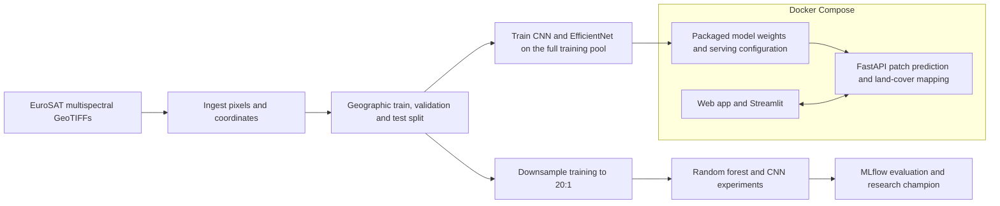

# Capstone: LULC Classification of Sentinel-2 Imagery Under Class Imbalance

DSA 8401 Applied Machine Learning capstone. Patrick Kiprono (Adm. 22274).

Classifies 64x64 Sentinel-2 patches from EuroSAT (Helber et al., 2019) into ten land-use / land-cover
classes, and asks **how well a CNN recognises minority classes when the training data is imbalanced, and
whether transfer learning with imbalance-aware training closes that gap.**

The [five-minute presentation](deliverables/EuroSAT_Capstone_5_Minute_Presentation.pptx)
and [analysis notebook](notebooks/capstone_report.ipynb) explain the modeling choices, results, and limitations.
See [AI_USE.md](AI_USE.md) for the AI use disclosure.

## Quick start with Docker

With Docker and the Compose plugin running, run this command from the repository root:

```bash
docker compose up --build -d --wait --wait-timeout 180
```

Open the [web app](http://localhost:8000/), [API docs](http://localhost:8000/docs), or
[Streamlit interface](http://localhost:8501/). The pretrained models and sample images are included.

```bash
curl --fail http://localhost:8000/health
curl --fail -F "file=@samples/Industrial.tif" http://localhost:8000/predict
curl --fail -F "file=@samples/Forest.png" http://localhost:8000/predict
docker compose down
```

In Windows PowerShell, use `curl.exe`.

## Architecture



## Results (untouched, spatially separated test set; training set imbalanced 20:1)

| Model | Loss | Test macro F1 | Minority macro F1 | Highway recall |
|---|---|---|---|---|
| Random forest (band stats + NDVI) | class-weighted | 0.837 | 0.781 | 0.31 |
| Custom CNN, RGB | cross-entropy | 0.763 | 0.680 | 0.14 |
| Custom CNN, RGB | class-weighted | 0.821 | 0.818 | 0.69 |
| Custom CNN, 13 bands | cross-entropy | 0.883 | 0.816 | 0.35 |
| **Custom CNN, 13 bands (champion)** | **class-weighted** | **0.926** | 0.906 | 0.74 |
| EfficientNet-B0, RGB | cross-entropy | 0.903 | 0.892 | 0.70 |
| EfficientNet-B0, RGB | class-weighted | 0.923 | **0.917** | **0.81** |
| EfficientNet-B0, RGB | focal | 0.910 | 0.899 | 0.73 |
| *Reference: custom CNN, 13 bands, balanced full training set* | cross-entropy | *0.970* | *0.964* | *0.93* |

Imbalance hits the rarest classes hardest (as few as 14% of highways found). Class weighting helped every
architecture; transfer learning was the largest single gain on RGB; the 13 spectral bands were worth as much as
ImageNet pretraining. Together they close roughly half to two-thirds of the gap to balanced training, not all of it.
Each configuration was trained once (seed 42), so differences of about 0.01 are within run-to-run noise.

## What the pipeline does

| Stage | Command | What it does |
|---|---|---|
| 1. Ingest | `python -m pipeline.ingest` | Downloads EuroSAT all-bands (2.07 GB) into `data/EuroSAT/` if missing, reads all 27,000 13-band GeoTIFFs and their centre lat/lon into `artifacts/` |
| 2. Split | `python -m pipeline.split` | 0.1° geographic blocks -> `StratifiedGroupKFold` (train / val / test, blocks never shared), then subsamples **train only** to a 20:1 geometric imbalance. Validation and test are untouched. Also checks how close test patches sit to training patches |
| 3. Samples | `python -m pipeline.make_samples` | One test patch per class into `samples/` (GeoTIFF + PNG) for the API, UI and tests |
| 4. Baseline | `python -m pipeline.baseline` | Random forest on per-band statistics + NDVI (unweighted, class-weighted, and on a random split for comparison) |
| 5. CNNs | `python -m pipeline.train --model {cnn,effnet} --bands {rgb,ms} --loss {ce,weighted_ce,focal}` | Custom 3-block CNN (RGB or 13 bands) and EfficientNet-B0 (ImageNet weights, frozen head training then partial fine-tuning). All with flip/rotation augmentation, early stopping on validation macro F1 |
| 6. Champion | `python -m pipeline.select_champion` | Builds the leaderboard, selects the imbalanced CNN by **validation** macro F1 (minimum 0.80), registers it in MLflow (`@champion`), and exports to `artifacts/research_champion/` |

`python run_pipeline.py` runs everything (the full experiment grid is listed in that file);
`python run_pipeline.py --from train` resumes from a stage.

Design choices that guard against leakage:
* Normalisation is a Keras `Normalization` layer adapted on the training set only and saved **inside**
  the model, so the API feeds raw pixels and cannot drift from training.
* The champion is chosen on validation; the test set is only reported.
* The RGB conversion (`pipeline/data.py: to_rgb8`) is the single function used by training and by the API.

## Experiment tracking

```bash
mlflow ui --backend-store-uri sqlite:///mlflow.db --port 5000
```

Every run logs its parameters, per-epoch curves, validation and test macro F1, minority-class macro F1,
per-class precision/recall/F1, a row-normalised confusion matrix and its test probabilities.

## Serving

```bash
uvicorn api.main:app --reload            # web platform: http://127.0.0.1:8000/   API docs: /docs
streamlit run ui/app.py                   # http://localhost:8501
pytest -q                                 # API tests (uses the exported champion and samples/)
docker compose up --build                 # API on :8000 and UI on :8501, in containers
```

`POST /predict` takes a file upload: a 13-band EuroSAT GeoTIFF (canonical) or an 8-bit RGB PNG/JPEG,
and returns the predicted class, its confidence and the top three classes:

```bash
curl -F "file=@samples/Industrial.tif" http://127.0.0.1:8000/predict
```

```json
{"predicted_class": "Industrial", "confidence": 0.9997,
 "top3": [{"class": "Industrial", "probability": 0.9997}, {"class": "Highway", "probability": 0.0002},
          {"class": "Residential", "probability": 0.0}],
 "model_version": 1}
```

**Deployed models differ from the research champion.** The 20:1 imbalanced training set was the experimental
condition being studied, not a constraint on deployment, so the platform serves models trained on the full
(roughly balanced) training pool, combined as below. The configuration was chosen on **validation** macro F1
among single models, 8-way test-time augmentation (TTA: average over all flips/rotations) and 13-band + RGB
ensembles. The resulting test scores are in `model/serving.json`. The submitted research champion is available
in [`research_model/`](research_model/).

| Upload | Prediction | Val macro F1 | Test macro F1 | Test Highway F1 |
|---|---|---|---|---|
| 13-band GeoTIFF (64x64) | average of `cnn_ms_ce_fulltrain` (`model/`) and `effnet_rgb_ce_fulltrain` (`model/rgb/`) on the true-colour bands, both with TTA | 0.983 | **0.986** | 0.98 |
| RGB PNG/JPEG (any size; centre-cropped, resized to 64x64) or 3-band GeoTIFF | `effnet_rgb_ce_fulltrain` with TTA | 0.957 | **0.956** | 0.93 |
| *Before (research champion / imbalanced EfficientNet, no TTA)* | | *0.932 / 0.921* | *0.926 / 0.923* | *0.80 / 0.86* |

`effnet_rgb_ce_fulltrain` is a new run: `python -m pipeline.train --model effnet --bands rgb --loss ce --train-set full`
(51 min on CPU; val macro F1 0.944 without TTA).

The response also carries `probabilities` (all ten classes), `model` (which one answered) and `preview`
(a PNG data URL, since browsers cannot display GeoTIFFs). The web page in `web/` (plain HTML/JS, no build step)
is served by FastAPI at `/`, with upload by drag-and-drop and one sample per class. Uploads are limited to 10 MB.
**Land-cover map (`POST /map`, the page's first tab).** For an image larger than one patch, `api/mapping.py`
slides the 64 px (640 m) window across it with overlap (stride 32 / 16 / 8 px for fast / normal / fine),
gives each pixel the centre-weighted average of the probabilities of every window covering it, and colours it by
the winning class. The response has the colour map, a confidence map, each class's share and area (ha), and a
small class grid for hover look-ups. Ground resolution is read from a projected GeoTIFF, entered by the user,
or assumed to be 10 m; the image is rescaled so a window always covers 640 m. This is patch-level mapping, not
per-pixel segmentation (EuroSAT has no pixel masks): boundaries are only as sharp as the stride.
`python -m pipeline.make_mosaic` builds the demo scene in `samples/` (48 held-out test patches in a 6x8 grid,
with its ground truth). With the deployed ensemble at normal detail the map gets 90% of pixels right (RGB: 86%),
and **99% (RGB: 98%) inside the tiles**: nearly all errors are within 16 px of the artificial seams between
unrelated tiles, which look like linear features (River/Highway). Maps do not use TTA: the overlapping windows
already average many views, and TTA cost 8x the time for no gain on the demo.

Photos that are not Sentinel-2 imagery (drone shots, Google Maps screenshots at other resolutions) are outside the
training distribution, so treat their predictions with caution.

`GET /model-info` returns which model is deployed, its input spec and its scores.

CI (`.github/workflows/ci.yml`) tests the packaged serving models through the API, builds both
Docker images and smoke-tests them. Training is not run in CI (it needs the 2 GB archive and hours of CPU).

## Reproduce the experiments

Use Python 3.12 in a virtual environment. Run from the repository root:

```bash
python -m pip install -r requirements.txt
python run_pipeline.py
python -m pipeline.train --model effnet --bands rgb --loss ce --train-set full
python -m pipeline.make_mosaic
python -m pytest -q
```

The first run downloads the EuroSAT multispectral archive (about 2 GB). Allow several additional GB
for packed image arrays, model checkpoints, and tracking data. The main pipeline reproduces the research
grid, including the full-training 13-band reference. The extra training command reproduces the
full-training RGB component. Weights go to `artifacts/models/`, and the pipeline exports the selected
research model to `artifacts/research_champion/`. API tests use the submitted weights and inference
configuration in `model/`. Open the notebook after training to rerun its analysis cells.

Developed on a CPU-only laptop (Ryzen 5 5500U, 8 GB RAM). The full grid takes several hours on that machine;
to keep it feasible, EfficientNet trains its head on frozen features computed once, then fine-tunes the top
40 layers with augmentation at 64x64.

## Layout

```
data/       EuroSAT download (git-ignored)
pipeline/   config, ingest, split, data, models, train, baseline, evaluate, select_champion, make_samples
api/        FastAPI service          ui/        Streamlit front end
tests/      API tests                samples/   one test patch per class
model/      serving models           reports/   figures and tables (split map, leaderboard, ...)
research_model/ submitted champion   deliverables/ final PowerPoint presentation
notebooks/  capstone_report.ipynb    artifacts/ packed data and trained runs (git-ignored)
logs/       pipeline logs            .github/   CI workflow
```

## Data and credits

The pipeline downloads [EuroSAT](https://github.com/phelber/EuroSAT), by Helber, Bischke, Dengel and
Borth. The repository includes a small set of images for the demos and tests. See the
[imagery attribution and dataset license](samples/NOTICE.md).
