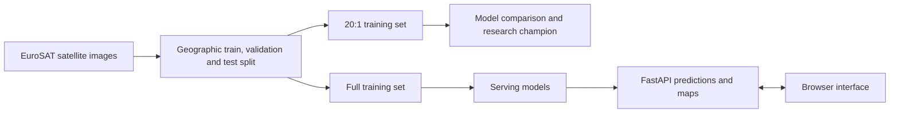

# EuroSAT land-cover classification

Patrick Kiprono (22274) · DSA 8401 Applied Machine Learning capstone

This project classifies Sentinel-2 satellite images into 10 land-use and land-cover classes, such as forest, river, and highway. It asks what happens when some classes have far fewer training examples and tests ways to improve their detection.

**Main result:** Class weighting helped the 13-band CNN correctly identify **74%** of highway images on the geographic test split, up from **35%**.

[Open the live EuroSAT app](https://eurosat-capstone.redsea-4270c728.southafricanorth.azurecontainerapps.io) on Azure Container Apps. The first request after a period of inactivity may take longer while the app starts.

[Final presentation](deliverables/EuroSAT_Capstone_5_Minute_Presentation_Full_Legend.pptx) · [Analysis notebook](notebooks/capstone_report.ipynb) · [AI use disclosure](AI_USE.md)

## Run the demo

Start Docker, then clone and run the project:

```bash
git clone https://github.com/kipronopato/EuroSAT_LULC_Capstone.git
cd EuroSAT_LULC_Capstone
docker compose up --build -d --wait --wait-timeout 180
```

Open the [web app](http://localhost:8000/). Try a sample in the **Classify a patch** tab or load the demo scene in the **Land-cover map** tab. Interactive [API docs](http://localhost:8000/docs) are also available.

The repository includes trained models and sample images. The demo runs without downloading EuroSAT or retraining.

```bash
curl --fail http://localhost:8000/health
curl --fail -F "file=@samples/Industrial.tif" http://localhost:8000/predict
docker compose down
```

Use `curl.exe` in Windows PowerShell. The last command stops both services.

## Key features

- **Patch classification.** Upload a 13-band GeoTIFF or an RGB image to see the predicted land-cover class and its top three scores.
- **Land-cover mapping.** Upload a larger scene to see a colour map, prediction confidence, and estimated area by class.
- **Reproducible experiments.** Compare models trained with and without class weighting on the same geographic test split.

## Technology stack

| Area | Tools |
| --- | --- |
| Web interface | HTML, CSS, JavaScript |
| API | FastAPI, Uvicorn |
| Data and models | Rasterio, NumPy, pandas, scikit-learn, Keras, TensorFlow |
| Experiment tracking | MLflow |
| Build and verification | Docker Compose, pytest, GitHub Actions |

## Dataset

| Property | Value |
| --- | ---: |
| Source | [EuroSAT Sentinel-2 imagery](https://github.com/phelber/EuroSAT) |
| Labelled patches | 27,000 |
| Patch size | 64 × 64 pixels |
| Spectral bands | 13 |
| Land-cover classes | 10 |
| Full training pool | 19,286 patches |
| Training pool after downsampling | 7,297 patches |
| Validation and test | 3,857 patches each |

## Machine-learning pipeline



1. Read the GeoTIFF pixels and patch coordinates.
2. Assign entire 0.1° geographic blocks to train, validation, or test to reduce leakage between nearby images.
3. Downsample the training pool to a 20:1 ratio between the most common and rarest classes.
4. Select the research champion by validation macro F1 and report its performance on the held-out test split.

## Models

| Model | Why it was used |
| --- | --- |
| Random forest | Baseline using band statistics and a vegetation index. |
| Custom CNN | Tests how much the 13 spectral bands help compared with RGB inputs. |
| EfficientNet-B0 | Tests an ImageNet-pretrained model on RGB inputs. |

## Results

Macro F1 gives each class equal weight. Minority macro F1 averages the F1 scores for Residential, River, Industrial, and Highway, the four rarest training classes. Highway recall is the share of highway images correctly identified.

| Model | Training loss | Test macro F1 | Minority macro F1 | Highway recall |
| --- | --- | ---: | ---: | ---: |
| Random forest | Class-weighted | 0.837 | 0.781 | 31% |
| RGB CNN | Cross-entropy | 0.763 | 0.680 | 14% |
| RGB CNN | Class-weighted | 0.821 | 0.818 | 69% |
| 13-band CNN | Cross-entropy | 0.883 | 0.816 | 35% |
| **13-band CNN (research champion)** | **Class-weighted** | **0.926** | 0.906 | 74% |
| RGB EfficientNet-B0 | Cross-entropy | 0.903 | 0.892 | 70% |
| RGB EfficientNet-B0 | Class-weighted | 0.923 | **0.917** | **81%** |
| RGB EfficientNet-B0 | Focal | 0.910 | 0.899 | 73% |
| 13-band CNN (full-training reference) | Cross-entropy | 0.970 | 0.964 | 93% |

The weighted RGB EfficientNet had the best minority macro F1 among the imbalanced runs. The full-training reference scored highest overall.

See the [full leaderboard](reports/leaderboard.csv) and [geographic split audit](reports/leakage_check.csv).

## Published models

The app uses models trained on the full training pool. The research champion comes from the 20:1 experiment.

| Artifact | Role |
| --- | --- |
| [13-band CNN](model/model.keras) | Combines with RGB EfficientNet for multispectral uploads. The ensemble scored **0.986 test macro F1**. |
| [RGB EfficientNet](model/rgb/model.keras) | Handles RGB uploads and scored **0.956 test macro F1** in the RGB pipeline. |
| [Research champion](research_model/) | Class-weighted 13-band CNN trained on the imbalanced pool. It scored **0.926 test macro F1**. |

The [serving configuration](model/serving.json) records the model combinations and scores.

## API

| Endpoint | Purpose |
| --- | --- |
| `POST /predict` | Classify a 64 × 64 GeoTIFF or an RGB PNG/JPEG. Returns the predicted class and scores. |
| `POST /map` | Map a larger image with overlapping patches. Returns a colour map, confidence, and estimated class areas. |
| `GET /map/demo` | View the map for a mosaic assembled from held-out EuroSAT patches. |
| `GET /model-info` | Inspect the active models, input format, and benchmark scores. |

Patch uploads have a 10 MB limit. Map uploads have a 60 MB limit.

## Deploy to Google Cloud Run

FastAPI serves the browser interface and the model endpoints from the same Docker container. With the Google Cloud CLI signed in to a billing-enabled project, deploy from the repository root:

```bash
gcloud run deploy eurosat-capstone --source . --project YOUR_PROJECT_ID --region africa-south1 --allow-unauthenticated --cpu 2 --memory 2Gi --concurrency 1 --min-instances 0 --max-instances 1 --timeout 180s
```

Open the service URL printed by Cloud Run to use the web app. The first request may take longer after the service scales to zero. For the public demo, keep uploads below 32 MiB to fit Cloud Run's HTTP/1 request limit. See the [Cloud Run source deployment guide](https://docs.cloud.google.com/run/docs/deploying-source-code) for project permissions and the [pricing page](https://cloud.google.com/run/pricing) for billing details.

## Reproduce the experiments

Use Python 3.12 in a virtual environment. The first run downloads about 2 GB of EuroSAT data. Allow several additional GB for processed images and model files, and several hours for training on CPU.

```bash
python -m pip install -r requirements.txt
python run_pipeline.py
```

The pipeline ingests images, creates the splits, saves demo patches, trains the baseline and CNNs, writes the [leaderboard](reports/leaderboard.csv), and exports the research champion to `artifacts/research_champion/`. To resume at training, run `python run_pipeline.py --from train`.

To retrain the full-training RGB component and rebuild the demo mosaic, run:

```bash
python -m pipeline.train --model effnet --bands rgb --loss ce --train-set full
python -m pipeline.make_mosaic
```

New training checkpoints go to `artifacts/models/`. The app and tests load the submitted weights from `model/`. After training, open the [analysis notebook](notebooks/capstone_report.ipynb) to rerun the analysis, or launch MLflow to browse the logged runs:

```bash
mlflow ui --backend-store-uri sqlite:///mlflow.db --port 5000
```

## Limitations

- Each training configuration ran once. Small differences between scores need replication.
- EuroSAT covers European Sentinel-2 scenes. Accuracy in other regions or with other imagery needs separate validation.
- Land-cover maps use overlapping windows of roughly 640 m. Boundaries are approximate.

## Tests and project files

Run `python -m pytest -q` after installing the project dependencies. [GitHub Actions](https://github.com/kipronopato/EuroSAT_LULC_Capstone/actions) also builds the Docker image and smoke-tests the web app and API.

| Location | Contents |
| --- | --- |
| [`pipeline/`](pipeline/) | Data preparation, training, and evaluation |
| [`api/`](api/), [`web/`](web/) | FastAPI service and web app |
| [`model/`](model/), [`research_model/`](research_model/) | Serving weights and the submitted research champion |
| [`samples/`](samples/), [`reports/`](reports/) | Demo imagery and evaluation outputs |
| [`notebooks/`](notebooks/), [`deliverables/`](deliverables/) | Analysis notebook and final presentation |

## Data credits

EuroSAT was created by Patrick Helber, Benjamin Bischke, Andreas Dengel, and Damian Borth. See the [imagery attribution and dataset license](samples/NOTICE.md).
