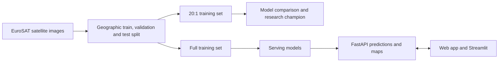

# EuroSAT land-cover classification

Patrick Kiprono (22274) · DSA 8401 Applied Machine Learning capstone

This project classifies Sentinel-2 satellite images into 10 land-use and land-cover classes, such as forest, river, and highway. It asks what happens when some classes have far fewer training examples and tests ways to improve their detection.

**Main result:** Class weighting helped the 13-band CNN correctly identify **74%** of highway images on the geographic test split, up from **35%**.

[Final presentation](deliverables/EuroSAT_Capstone_5_Minute_Presentation.pptx) · [Analysis notebook](notebooks/capstone_report.ipynb) · [AI use disclosure](AI_USE.md)

## Run the demo

Start Docker, then run this command from the repository root:

```bash
docker compose up --build -d --wait --wait-timeout 180
```

Open the [web app](http://localhost:8000/). Try a sample in the **Classify a patch** tab or load the demo scene in the **Land-cover map** tab. You can also open the [API docs](http://localhost:8000/docs) or the [Streamlit interface](http://localhost:8501/).

The repository includes trained models and sample images. The demo runs without downloading EuroSAT or retraining.

```bash
curl --fail http://localhost:8000/health
curl --fail -F "file=@samples/Industrial.tif" http://localhost:8000/predict
docker compose down
```

Use `curl.exe` in Windows PowerShell. The last command stops both services.

## How it works



EuroSAT contains 27,000 labelled images at 64 × 64 pixels with 13 spectral bands. The pipeline assigns entire 0.1° geographic blocks to train, validation, or test to reduce leakage between nearby images. For the imbalance experiment, it downsamples the training set until the most common class has 20 times as many examples as the rarest. The validation and test splits retain 3,857 images each.

The random forest uses band statistics and a vegetation index as a baseline. The custom CNN compares RGB and all 13 bands. EfficientNet-B0 tests ImageNet transfer learning on RGB. The pipeline chooses the best imbalanced CNN by validation macro F1 and reports its performance on the held-out test split.

## Results

Macro F1 gives each class equal weight. Minority macro F1 averages the F1 scores for Residential, River, Industrial, and Highway, the four rarest training classes. Highway recall is the share of highway images correctly identified.

| Model | Training loss | Test macro F1 | Minority macro F1 | Highway recall |
| --- | --- | ---: | ---: | ---: |
| Random forest | Class-weighted | 0.837 | 0.781 | 31% |
| RGB CNN | Cross-entropy | 0.763 | 0.680 | 14% |
| RGB CNN | Class-weighted | 0.821 | 0.818 | 69% |
| 13-band CNN | Cross-entropy | 0.883 | 0.816 | 35% |
| **13-band CNN (research champion)** | **Class-weighted** | **0.926** | 0.906 | 74% |
| RGB EfficientNet-B0 | Cross-entropy | 0.903 | 0.892 | 70% |
| RGB EfficientNet-B0 | Class-weighted | 0.923 | **0.917** | **81%** |
| RGB EfficientNet-B0 | Focal | 0.910 | 0.899 | 73% |
| 13-band CNN (full-training reference) | Cross-entropy | 0.970 | 0.964 | 93% |

The weighted RGB EfficientNet had the best minority macro F1 among the imbalanced runs. Each configuration ran once, so small score differences need replication. All results use European EuroSAT imagery. Performance in other regions or with other image sources needs separate validation.

See the [full leaderboard](reports/leaderboard.csv) and [geographic split audit](reports/leakage_check.csv).

## What the app serves

| Endpoint | Purpose |
| --- | --- |
| `POST /predict` | Classify a 64 × 64 GeoTIFF or an RGB PNG/JPEG. Returns the predicted class and scores. |
| `POST /map` | Map a larger image with overlapping patches. Returns a colour map, confidence, and estimated class areas. |
| `GET /map/demo` | View the map for a mosaic assembled from held-out EuroSAT patches. |
| `GET /model-info` | Inspect the active models, input format, and benchmark scores. |

Patch uploads have a 10 MB limit. Map uploads have a 60 MB limit. The map estimates class boundaries from overlapping predictions over roughly 640 m windows, so the output has limited boundary precision.

The app uses models trained on the full training pool. On the spatial test set, the 13-band upload pipeline scored **0.986 macro F1**, while the RGB pipeline scored **0.956**. The 13-band pipeline averages the multispectral CNN and RGB EfficientNet. See the [serving configuration](model/serving.json) and [research champion](research_model/).

## Reproduce the experiments

Use Python 3.12 in a virtual environment. The first run downloads about 2 GB of EuroSAT data. Allow several additional GB for processed images and model files, and several hours for training on CPU.

```bash
python -m pip install -r requirements.txt
python run_pipeline.py
```

The pipeline ingests images, creates the splits, saves demo patches, trains the baseline and CNNs, writes the [leaderboard](reports/leaderboard.csv), and exports the research champion to `artifacts/research_champion/`. To resume at training, run `python run_pipeline.py --from train`.

To retrain the full-training RGB component and rebuild the demo mosaic, run:

```bash
python -m pipeline.train --model effnet --bands rgb --loss ce --train-set full
python -m pipeline.make_mosaic
```

New training checkpoints go to `artifacts/models/`. The app and tests load the submitted weights from `model/`. After training, open the [analysis notebook](notebooks/capstone_report.ipynb) to rerun the analysis, or launch MLflow to browse the logged runs:

```bash
mlflow ui --backend-store-uri sqlite:///mlflow.db --port 5000
```

## Tests and project files

Run `python -m pytest -q` after installing the project dependencies. [GitHub Actions](https://github.com/kipronopato/EuroSAT_LULC_Capstone/actions) also builds the Docker images and smoke-tests the API and Streamlit.

| Location | Contents |
| --- | --- |
| [`pipeline/`](pipeline/) | Data preparation, training, and evaluation |
| [`api/`](api/), [`web/`](web/), [`ui/`](ui/) | FastAPI service, web app, and Streamlit |
| [`model/`](model/), [`research_model/`](research_model/) | Serving weights and the submitted research champion |
| [`samples/`](samples/), [`reports/`](reports/) | Demo imagery and evaluation outputs |
| [`notebooks/`](notebooks/), [`deliverables/`](deliverables/) | Analysis notebook and final presentation |

## Data credits

The project uses [EuroSAT](https://github.com/phelber/EuroSAT) by Patrick Helber, Benjamin Bischke, Andreas Dengel, and Damian Borth. See the [imagery attribution and dataset license](samples/NOTICE.md).
